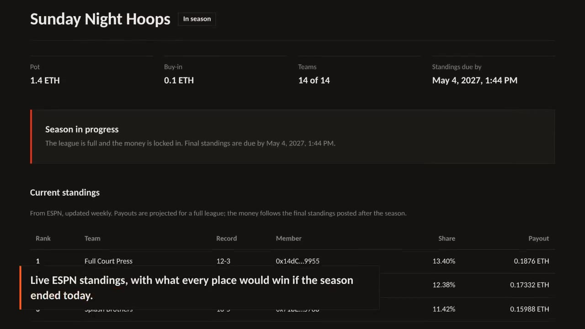

# On-Chain Commish

**The commissioner every fantasy league can trust.**

Fantasy league buy-ins usually sit in one person's Venmo until the season ends. On-Chain Commish holds them in a smart contract instead, then pays every team out by its final ESPN standings. No one can run off with the pot, including the commissioner.

[](frontend/public/demo/walkthrough.mp4)

*A full season in 40 seconds: create a league from an ESPN link, managers join, live standings, final standings posted on-chain, payouts claimed.*

- **Live app:** [onchaincommissioner.vercel.app](https://onchaincommissioner.vercel.app) (Base Sepolia testnet, test USDC only)
- **Contract:** [`0x2711…d2ad` on BaseScan](https://sepolia.basescan.org/address/0x2711e4e095f4fddee31f3ae7125acc4521c6d2ad#code) (verified source). An earlier version of the contract, which took test ETH, is still on Ethereum Sepolia at [`0xd39e…508F`](https://sepolia.etherscan.io/address/0xd39e4462F49009C15702638A7fAd34BC48Fa508F#code).

## How a season works

1. **Create.** The commissioner pastes their ESPN league link. Team names and league size come from ESPN; the commissioner sets the buy-in and deadlines, then pays in as the first team.
2. **Join.** Each manager opens the invite link, picks their ESPN team and pays the buy-in into the contract. The league starts once every team has joined.
3. **Track.** During the season, the league page shows live ESPN standings and what each place would win today.
4. **Settle.** After the season, a standings bot posts ESPN's final ranking on-chain. Members have 48 hours to dispute it.
5. **Get paid.** If no one disputes, anyone can finalize, and every manager claims their share. Payouts are split across all places, so every team gets something back.

## The trust model

The point of the project is that no single person controls the money or the result.

| Risk | How it's handled |
|---|---|
| The commissioner keeps the pot | Buy-ins go straight into the contract. Nothing lets anyone withdraw them except the payout and refund rules. |
| Someone posts fake standings | Only the league's reporter, a neutral bot that copies public ESPN data, can post standings. The reporter can never have a team in the league. |
| The bot gets it wrong | Any member can dispute within 48 hours. Members then vote on corrected standings, and a majority makes them final. The commissioner gets one vote like everyone else. |
| The season falls apart | If the league never fills, standings are never posted, or a dispute isn't resolved within 7 days, everyone can withdraw their full buy-in. |

Payouts use the pull pattern: each member claims their own share, so one wallet that can't receive ETH never blocks the others.

## Architecture

```
ESPN fantasy API (public leagues)
        │
        ├── Serverless function (/api/espn)  ── cached until each week's matchups end
        │        │
        │        ▼
        │   React app (Vite, wagmi, viem, RainbowKit, shadcn/ui)  ◀── players' wallets
        │        │
        ▼        ▼
Standings bot ──▶ LeagueTreasury.sol (Base Sepolia)
(GitHub Actions,     buy-ins, members, standings, disputes, votes, payouts
 runs daily)
```

- **`src/LeagueTreasury.sol`:** the contract. Leagues move through `OPEN → ACTIVE → STANDINGS_SUBMITTED → (DISPUTED →) FINALIZED`, or to `CANCELLED` with refunds. Payout tables are in basis points, and rounding dust goes to first place so payouts always add up to the pot exactly. League info and member lists live in storage, so the app and bot read them with plain calls and work on any RPC plan.
- **`test/`:** 142 Foundry tests (unit, fuzz, invariant and integration), including fuzz tests proving payouts and refunds always sum to exactly what was paid in, invariant tests that run random sequences of joins, standings, disputes, claims and cancellations and check the contract always holds exactly the USDC it owes (never stuck, never insolvent), plus malicious-wallet tests for reentrancy and rejected transfers. CI also runs Slither static analysis and checks the gas snapshot.
- **`frontend/`:** the React app. Design tokens in `src/index.css`, shadcn/ui components, and one action card per thing a user can do, chosen from the league's state, the chain's clock and the viewer's role.
- **`frontend/server/espn.mjs`:** reads ESPN and trims it to names, records and ranks. It runs inside the dev server locally and as a Vercel Function in production (`frontend/api/espn.mjs`).
- **`frontend/scripts/report.mjs`:** the standings bot. It checks every league it reports for, skips each until ESPN marks the season final, then posts the ranking. `.github/workflows/standings-bot.yml` runs it daily.

## Run it locally

Requires [Foundry](https://book.getfoundry.sh) and Node 20+.

```bash
make frontend-install
make anvil                                  # terminal 1: local chain, 20 funded accounts
make deploy-anvil && make abi && make dev-wallet   # terminal 2: app at http://localhost:5173
```

`make dev-wallet` lets you act as any test account from a dropdown, so you can play commissioner and every manager without MetaMask. Post standings locally with `make report LEAGUE=0` (add `TEST=1` to post a season that isn't over yet).

```bash
make test        # contract tests
make coverage    # coverage report
```

Deploying to Base Sepolia and Vercel is covered step by step in [DEPLOY.md](DEPLOY.md).

## Stack

- **Contract:** Solidity 0.8, Foundry
- **App:** React 19, TypeScript, Vite, Tailwind CSS v4, shadcn/ui (Base UI)
- **Web3:** wagmi, viem, RainbowKit
- **Infrastructure:** Vercel Functions, GitHub Actions, Base Sepolia

Test network only. No real money.
